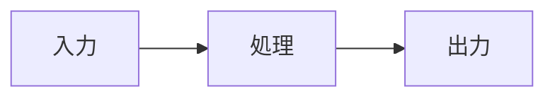

# レビューレポート方針・テンプレート（Report Format）

本ドキュメントは、親エージェントがレビュー後またはエスカレーション時に、対象の PR へ載せるレポートの形式を定義する。
目的は**「人間が 30 秒〜数分で変更の全体像とリスクを把握し、マージ可否を判断できる状態を作ること」**である。

## 1. 提出先
- 対象 PR への `gh pr comment` に、このテンプレートをそのまま載せる。人間がマージを判断するための文章、画像、図は、このコメントに置く。
- 子が作る PR 本文は、`Closes #<番号>`、変更点、テスト結果までとする。AI レビューサマリーと視覚補助は、実装した子ではなく親がコメントする。
- チャットでは PR の URL とマージの依頼を伝える。レポート全文やスクリーンショットをチャットだけに置いて、PR に載せないことはしない。
- `gh pr merge` は実行しない。マージは人間が GitHub 上で行う。

## 2. 視覚補助のルール（条件付き・ノイズ防止）
毎回すべてを付けるのではなく、以下の条件に該当する場合のみ、同じ PR コメントに添付する。

- **スクリーンショット（UI に影響する変更がある場合は必須）**
  - 変更前（Before）と変更後（After）の画像を、`gh pr comment --attach` でアップロードしてコメントに含める。ローカルパスだけを書かない。
  - Orca 環境の場合は `orca snapshot` や `orca screenshot` で取得する。
- **Mermaid 図（構造が変わる場合のみ）**
  - **対象:** データフロー、状態遷移、DB スキーマ、API シーケンス、モジュール間の依存関係が変わった場合。
  - **非対象:** 単純なバグ修正、文言変更、単一関数内のロジック修正では省略する。
  - 図は同じ PR コメントの Markdown に書く。

## 3. 出力テンプレート（このまま埋めて使用すること）

```markdown
## 🤖 AI レビューサマリー

- **対象 Issue:** #<Issue番号>
- **判定:** ✅ レビュー通過（人間承認待ち） / ⚠️ エスカレーション（要人間対応）
- **自動差し戻し回数:** <0〜2> 回

### 1. 検証結果チェックリスト
| 観点 | 結果 | 補足 |
| :--- | :---: | :--- |
| 仕様整合性 | ✅ / ⚠️ / ❌ | <受け入れ条件の充足状況・スコープ逸脱の有無> |
| エッジケース・安全性 | ✅ / ⚠️ / ❌ | <確認した異常系・セキュリティ観点> |
| テストの妥当性 | ✅ / ⚠️ / ❌ | <実行したコマンドと結果、テストの網羅性> |
| 既存コードへの影響 | ✅ / ⚠️ / ❌ | <破壊的変更の有無、規約との整合性> |

### 2. 差し戻しと修正の履歴
<!-- 初回で通過した場合は「差し戻しなし」と記載 -->
- **1回目:** <指摘した内容> → <どう修正されたか>

### 3. 残存リスク・AI の迷い（人間が重点的に見るべき箇所）
<!-- 最も重要なセクション。確信度が低い箇所や判断が分かれる箇所を具体的に記載 -->
- `<ファイルパス>:<行番号>` — <確認してほしい理由・懸念点>
- （特になければ「特段の懸念なし」と記載）

### 4. 未対応の軽微な指摘（Nice to have）
<!-- 今回は差し戻さなかった改善提案 -->
- `<ファイルパス>` — <提案内容>
- （特になければ「なし」と記載）

### 5. 視覚補助（該当する場合のみ記載・不要ならセクションごと削除）
<!-- UI変更時: Before / After のスクリーンショットを添付 -->
<!-- 構造変更時: 以下のように Mermaid 図を記載 -->
<!--

-->
```
